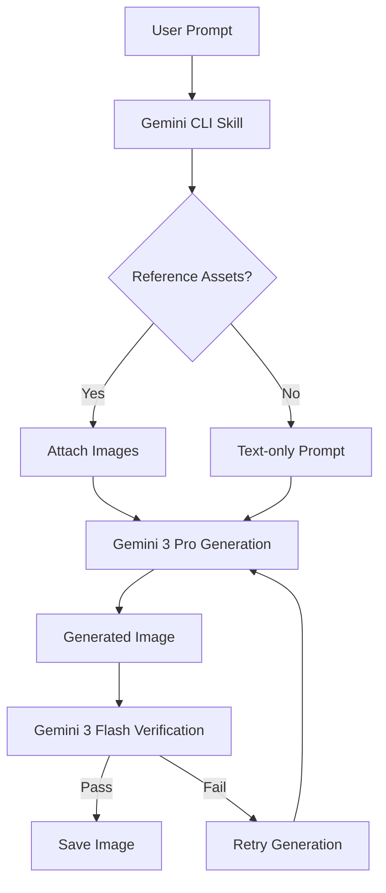

# Image Generation Expert (Gemini CLI Skill)

This repository provides an advanced image generation and verification skill for the [Gemini CLI](https://geminicli.com). It leverages Google's **Gemini 3 Pro** (Nano Banana Pro) for state-of-the-art image synthesis and **Gemini 3 Flash** for programmatic quality and compliance verification.

## 🚀 Features

1.  **High-Fidelity Generation**: Uses `gemini-3-pro-image-preview`.
2.  **Character Consistency**: Supports multimodal reference images to maintain identity (e.g., specific characters, logos, or styles) across multiple generations. Includes built-in assets for quick reference.
3.  **Automated Verification**: Uses `gemini-3-flash-preview` to automatically evaluate generated images against your prompt constraints, ensuring high quality and subject accuracy.
4.  **Custom Aspect Ratios**: Easily generate images in 16:9, 1:1, or 4:3 formats.

## 🏗️ Architecture & Workflow

The skill follows a "Generate-Verify-Retry" loop to ensure high-quality outputs that adhere to the user's intent.



## 📁 Repository Structure

```text
.
├── .gemini/            # Vector Protocol state and context
├── assets/             # Built-in character reference images
│   ├── char-unit9.png  # Unit 9 (Cyberpunk Cat)
│   └── ...             # Other character assets
├── references/         # Placeholder for external references
├── scripts/
│   └── image_gen.py    # Core generation & verification script
├── CONTRIBUTING.md     # Developer guide
├── README.md           # This file
├── SKILL.md            # Skill definition for Gemini CLI
└── requirements.txt    # Python dependencies
```

## 🛠️ Prerequisites

*   [Gemini CLI](https://geminicli.com/docs/getting-started) installed.
*   Python 3.9+
*   A valid Google AI Studio or Google Cloud API Key with access to the Gemini 3 Pro/Flash models.

## 📦 Installation

You can install this skill directly using the Gemini CLI.

### Option 1: Install from GitHub (Recommended)

To install this skill directly from the repository into your local workspace:

```bash
gemini skills install https://github.com/YOUR_ORG/image-gen-expert.git --scope workspace
```

*(Note: If you want this available across all your projects globally, change `--scope workspace` to `--scope user` or omit the flag).*

### Option 2: Install from Source (For Development)

If you clone the repository locally and want to use or edit the skill:

1.  Clone the repository:
    ```bash
    git clone https://github.com/YOUR_ORG/image-gen-expert.git
    cd image-gen-expert
    ```

2.  Link the local folder to your Gemini CLI workspace:
    ```bash
    gemini skills link .
    ```

### Post-Installation

**Important:** After installing or linking, you must open an interactive Gemini CLI session and run the following command to make the skill active:

```bash
/skills reload
```

## 🐍 Python Environment Setup

The underlying scripts used by this skill require specific Python packages. If you intend to run the `image_gen.py` script manually, set up your environment:

1.  Create a virtual environment (recommended):
    ```bash
    python -m venv .venv
    source .venv/bin/activate
    ```
2.  Install dependencies:
    ```bash
    pip install -r requirements.txt
    ```
3.  Set your API Key:
    ```bash
    export GOOGLE_API_KEY="your-api-key-here"
    ```

## 📖 Usage

Once the skill is installed and loaded into Gemini CLI, you can simply ask the agent to use it:

> "Use the image-gen-expert skill to create a cyberpunk cat detective. Make sure he's wearing a trenchcoat."

### Advanced Examples

**Maintaining Character Consistency:**
> "Generate an image of Unit 9 (using assets/char-unit9.png) in a high-speed chase through a neon-lit rain-slicked street. 16:9 aspect ratio."

**Text Integration & Verification:**
> "Create a vintage-style travel poster for 'MARS COLONY'. Ensure the text is clear and readable."

### Manual Script Usage

You can also run the core generation script directly from your terminal:

```bash
python scripts/image_gen.py --prompt "Unit 9 (Cyberpunk Cat) drinking coffee" --references "assets/char-unit9.png" --output "unit9_coffee.png"
```

Use `python scripts/image_gen.py --help` for a full list of arguments.

## 🤝 Contributing

Contributions are welcome! Please see [CONTRIBUTING.md](CONTRIBUTING.md) for details on our development process and standards.

## Disclaimer

This is not an officially supported Google product.

## License

This project is licensed under the Apache License, Version 2.0. See the [LICENSE](LICENSE) file for details.
