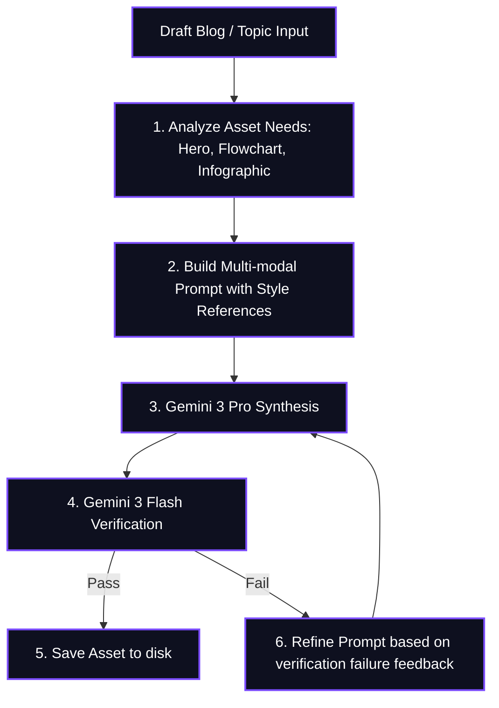

> [!IMPORTANT]
> **DISCLAIMER & LIABILITY NOTICE**: This is a **personal, individual project** created and maintained entirely by the author (Prashanth). It is **not** an official Google product, it is **not** affiliated with or supported by Google Cloud or Google LLC, and it does **not** come with any official support or warranty. By using this software, you acknowledge that you are solely liable for its use.

# 🎨 Image Gen Expert

[](https://skills.sh)


An advanced, high-fidelity custom skill and script pipeline for autonomous visual asset, diagram, and infographic generation inside your agent workspace.

The **Image Gen Expert** uses Google's state-of-the-art **Gemini 3 Pro** (Nano Banana Pro) for image synthesis and **Gemini 3 Flash** for programmatic, multi-step quality and compliance verification. It automatically analyzes drafts to determine visual requirements (heroes, flowcharts, or infographics) and generates them from scratch, matching your corporate brand's style guide.

---

## 🔄 Generate-Verify-Retry Loop

The skill executes an autonomous verification loop to ensure that all generated graphics (especially those containing text labels) are legible, correct, and professional before saving:



---

## 📂 Repository Structure

The package contents are fully organized for installation via `npx skills`:

| Path | Type | Purpose |
| :--- | :--- | :--- |
| `skills/image-gen-expert/SKILL.md` | Core Instructions | Detailed prompt patterns, aspect ratio mapping rules, and verifier heuristics. |
| `skills/image-gen-expert/scripts/image_gen.py` | Python Engine | Executable script that interfaces with Google GenAI API to generate and verify images. |
| `skills/image-gen-expert/assets/` | Brand Guides | Location to store style guidelines and reference pictures. |
| `requirements.txt` | Python Requirements | Defines python libraries required (`google-genai`, `Pillow`). |

---

## 🛠️ Installation & Usage

Install this skill into your agent environment using `npx skills`:

```bash
npx skills add ksprashu/skills-image-gen-expert
```

### Setup Requirements
1. **API Key**: Ensure `GOOGLE_API_KEY` is exported in your environment. If not found, the agent will securely prompt you for it during your interactive session.
2. **Python Environment**:
   ```bash
   python -m venv .venv
   source .venv/bin/activate
   pip install -r requirements.txt
   ```

### Execution Example

To generate custom graphics matching your draft, ask the agent:

> *"Read my `auth_design.md` and use image-gen-expert to create a 16:9 hero banner and a 4:3 flowchart diagram. Use `assets/corporate_brand.png` as our style reference."*
