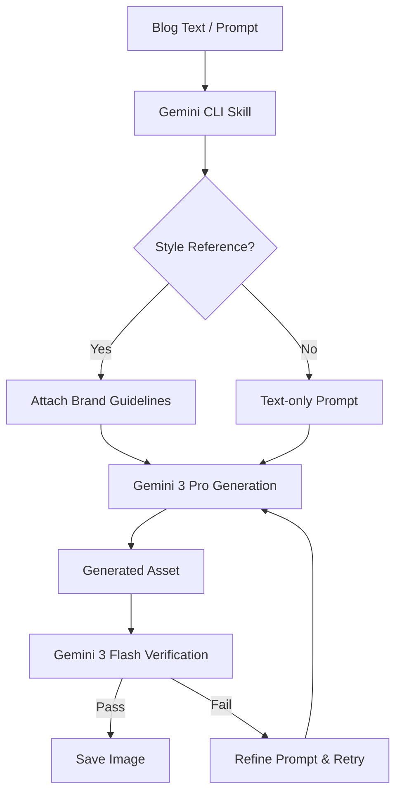

> [!IMPORTANT]
> **DISCLAIMER & LIABILITY NOTICE**: This is a **personal, individual project** created and maintained entirely by the author (Prashanth). It is **not** an official Google product, it is **not** affiliated with or supported by Google Cloud or Google LLC, and it does **not** come with any official support or warranty. By using this software, you acknowledge that you are solely liable for its use.

# Blog & Content Image Generation Expert (Gemini CLI Skill)

[](https://skills.sh)

This repository provides an advanced, dynamic image and visual asset generation skill for the Gemini CLI. It leverages Google's **Gemini 3 Pro** (Nano Banana Pro) for state-of-the-art visual synthesis and **Gemini 3 Flash** for programmatic quality and compliance verification.

Designed specifically for technical writing, blogs, and documentation, this skill autonomously determines the right type of asset (e.g., hero image, flowchart, infographic) and generates it from scratch while maintaining your brand's style.

## 🚀 Features

1.  **Dynamic Asset Needs Analysis**: Instruct the agent to read a draft blog post, and it will automatically plan and generate the required visual assets (heroes, inline diagrams, infographics).
2.  **High-Fidelity Generation**: Uses `gemini-3-pro-image-preview` for complex image and diagram generation.
3.  **Brand & Style Consistency**: Supports multimodal reference images (`--references`) to maintain a specific visual style, color palette, or branding across multiple generations without relying on legacy character templates.
4.  **Automated Verification**: Uses `gemini-3-flash-preview` to automatically evaluate generated images against your prompt constraints (especially text legibility in diagrams), ensuring high quality and subject accuracy.
5.  **Custom Aspect Ratios**: Easily generate images in 16:9 (heroes), 1:1 (icons), or 4:3 (diagrams) formats.

## 🏗️ Architecture & Workflow

The skill follows a "Generate-Verify-Retry" loop to ensure high-quality outputs that adhere to the user's intent.



## 📁 Repository Structure

```text
.
├── .gemini/            # Vector Protocol state and context
├── assets/             # Directory for your brand/style reference guides
├── references/         # Placeholder for external references
├── scripts/
│   └── image_gen.py    # Core generation & verification script
├── CONTRIBUTING.md     # Developer guide
├── README.md           # This file
├── SKILL.md            # Skill definition for Gemini CLI
└── requirements.txt    # Python dependencies
```

## 🛠️ Prerequisites

*   Gemini CLI installed.
*   Python 3.9+
*   A valid Google AI Studio or Google Cloud API Key with access to the Gemini 3 Pro/Flash models. In interactive sessions, the agent will securely prompt you for this key if it is not already set in your environment.

## 📦 Installation

### Recommended: Using `npx skills`
Install this skill into your agent environment using `npx skills`:

```bash
npx skills add ksprashu/skills-image-gen-expert
```

### Alternative: Install using Gemini CLI
To install this skill directly from the repository into your local workspace:

```bash
gemini skills install https://github.com/ksprashu/skills-image-gen-expert.git --scope workspace
```

*(Note: If you want this available across all your projects globally, change `--scope workspace` to `--scope user` or omit the flag).*

### Option 2: Install from Source (For Development)

If you clone the repository locally and want to use or edit the skill:

1.  Clone the repository:
    ```bash
    git clone https://github.com/ksprashu/skills-image-gen-expert.git
    cd skills-image-gen-expert
    ```

2.  Link the local folder to your Gemini CLI workspace:
    ```bash
    gemini skills link .
    ```

### Post-Installation

**Important:** After installing or linking, you must open an interactive Gemini CLI session and run the following command to make the skill active:

```bash
/skills reload
```

## 🐍 Python Environment Setup

The underlying scripts used by this skill require specific Python packages. If you intend to run the `image_gen.py` script manually, set up your environment:

1.  Create a virtual environment (recommended):
    ```bash
    python -m venv .venv
    source .venv/bin/activate
    ```
2.  Install dependencies:
    ```bash
    pip install -r requirements.txt
    ```
3.  Set your API Key (Optional for interactive use):
    ```bash
    export GOOGLE_API_KEY="your-api-key-here"
    ```
    *Note: If you skip this, the Gemini CLI agent will securely prompt you for the key when you first attempt to generate an image.*

## 📖 Usage

Once the skill is installed and loaded into Gemini CLI, you can ask the agent to use it for your content:

> "Read my `blog_draft.md` and use the image-gen-expert skill to generate a 16:9 hero image for the header, and an infographic explaining the architecture in section 2."

### Advanced Examples

**Maintaining Brand Consistency:**
> "Generate an infographic explaining a CI/CD pipeline. Use `assets/brand-style-guide.png` as a style reference so the colors match our corporate theme."

**Text Integration & Verification:**
> "Create a flowchart diagram showing user authentication. Ensure the boxes contain clear, readable text like 'Login' and 'Token Validation'."

### Manual Script Usage

You can also run the core generation script directly from your terminal:

```bash
python scripts/image_gen.py --prompt "A cinematic, wide-shot hero image representing modern cloud architecture" --ar "16:9" --output "hero.png"
```

Use `python scripts/image_gen.py --help` for a full list of arguments.

## 🤝 Contributing

Contributions are welcome! Please see [CONTRIBUTING.md](CONTRIBUTING.md) for details on our development process and standards.

## Disclaimer

This is not an officially supported Google product.

## License

This project is licensed under the Apache License, Version 2.0. See the [LICENSE](LICENSE) file for details.
