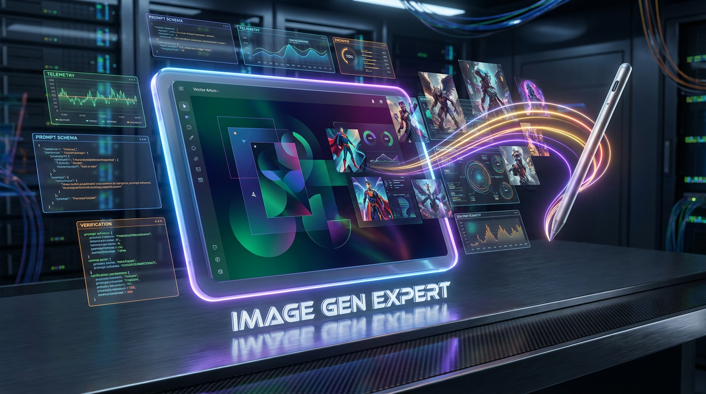
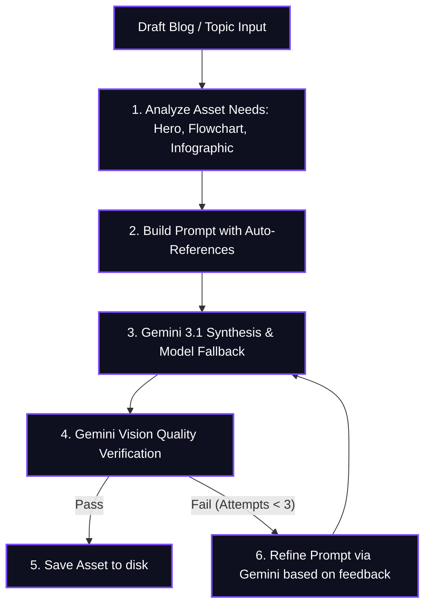

> [!IMPORTANT]
> **DISCLAIMER & LIABILITY NOTICE**: This is a **personal, individual project** created and maintained entirely by the author (Prashanth). It is **not** an official Google product, it is **not** affiliated with or supported by Google Cloud or Google LLC, and it does **not** come with any official support or warranty. By using this software, you acknowledge that you are solely liable for its use.

# 🎨 Image Gen Expert

[](https://skills.sh)



An advanced, high-fidelity custom skill and script pipeline for autonomous visual asset, diagram, and infographic generation inside your agent workspace.

The **Image Gen Expert** uses Google's state-of-the-art **Gemini 3.1 Flash Image** (Nano Banana 2) for versatile 4K image synthesis with an intelligent capability-aware fallback chain (`gemini-3.1-flash-image` ➔ `gemini-3.1-flash-lite-image` ➔ `gemini-3-pro-image`), alongside Gemini vision for multi-step quality and compliance verification.

---

## 🌟 Key Features

1. **Intelligent Model Selection & Fallback**:
   * Default Primary: `gemini-3.1-flash-image` (Nano Banana 2 workhorse, 4K rendering, accurate text, multi-reference grounding).
   * Secondary Fallback: `gemini-3.1-flash-lite-image` (Fast & lightweight; automatically bypassed if reference images are provided as flash-lite is not optimized for multi-reference input).
   * Tertiary Fallback: `gemini-3-pro-image` (Nano Banana Pro for complex precision rendering and brand consistency).
2. **Automatic Series Style Grounding**: When generating multiple graphics for an article (Hero, Architecture Diagram, Infographic), the agent automatically uses the first generated graphic as a style reference for all subsequent figures to ensure visual continuity.
3. **Image Editing & Iterative Refinement**: Edit existing graphics by passing the original file as a reference (`--references arch.png`), preserving layout and structure while applying requested modifications.
4. **Generate-Verify-Refine Control Loop**: Retries up to **3 times** by default, using Gemini Vision to verify text legibility, subject accuracy, and quality constraints.
5. **Flexible Aspect Ratios**: Full support for `16:9` (Heroes), `4:3` / `1:1` (Diagrams & Icons), `3:4` / `9:16` (Tall Infographics & Mobile).

---

## 🔄 Generate-Verify-Retry Loop Architecture



---

## 📂 Repository Structure

The package contents are fully organized for installation via `npx skills`:

| Path | Type | Purpose |
| :--- | :--- | :--- |
| `skills/image-gen-expert/SKILL.md` | Core Instructions | Detailed prompt patterns, aspect ratio mapping rules, and auto-reference guidelines. |
| `skills/image-gen-expert/scripts/image_gen.py` | Python Engine | Executable script that interfaces with Google GenAI API with model fallback chain. |
| `skills/image-gen-expert/assets/` | Style Guides | Optional location to store brand style guidelines and reference pictures. |
| `docs/images/header.png` | Banner Image | Header image asset for repository documentation. |
| `docs/master_roadmap.html` | Portal | System architecture and project roadmap. |
| `requirements.txt` | Python Requirements | Defines python libraries required (`google-genai`, `Pillow`). |

---

## 🛠️ Installation & Usage

Install this skill into your agent environment using `npx skills`:

```bash
npx skills add ksprashu/skills-image-gen-expert
```

### Setup Requirements
1. **API Key**: Ensure `GOOGLE_API_KEY` is exported in your environment. If not found, the agent will securely prompt you for it during your interactive session.
2. **Python Environment**:
   ```bash
   python -m venv .venv
   source .venv/bin/activate
   pip install -r requirements.txt
   ```

### Command Line Reference

```bash
python skills/image-gen-expert/scripts/image_gen.py \
  --prompt "A cinematic wide-shot hero banner representing microservices" \
  --ar "16:9" \
  --max-attempts 3 \
  --output "hero.png"
```

| Parameter | Description | Default |
| :--- | :--- | :--- |
| `--prompt` | **Required.** The text description or edit instructions. | N/A |
| `--references` | Comma-separated paths to reference images for style grounding or editing. | None |
| `--ar` | Aspect ratio (`16:9`, `1:1`, `4:3`, `3:2`, `2:3`, `3:4`, `9:16`). | `1:1` |
| `--output` | Target output image filepath. | `output.png` |
| `--max-attempts` | Maximum attempts for generate-verify-refine loop. | `3` |
| `--no-verify` | Skip automated verification step. | False |
| `--model` | Primary image generation model. | `gemini-3.1-flash-image` |
| `--verifier-model` | Model used for automated vision verification. | `gemini-3.1-flash-image` |

---

### Execution Examples

**1. Standalone Hero Banner:**
```bash
python skills/image-gen-expert/scripts/image_gen.py --prompt "A cinematic hero image representing microservices" --ar "16:9" --output "hero.png"
```

**2. Auto-Grounded Series Diagram (Reusing Hero Style):**
```bash
python skills/image-gen-expert/scripts/image_gen.py --prompt "An architecture diagram for microservices" --references "hero.png" --ar "4:3" --output "arch.png"
```

**3. Editing an Existing Image:**
```bash
python skills/image-gen-expert/scripts/image_gen.py --prompt "Based on the reference, add a Redis cache box next to DB" --references "arch.png" --ar "4:3" --output "arch_v2.png"
```
